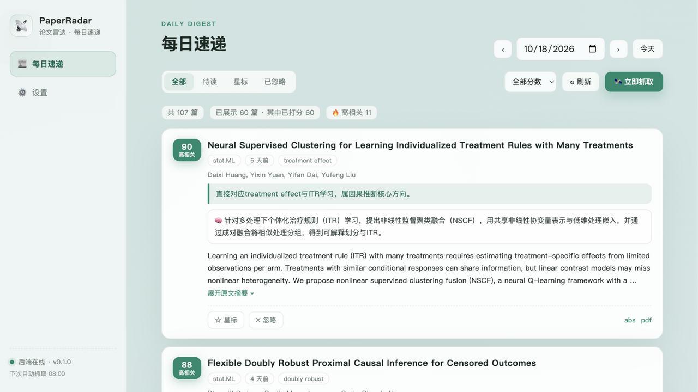

<div align="center">

# 📡 PaperRadar 论文雷达

**arXiv 每天几百篇，属于你方向的只有几篇——让 LLM 每天早上把这几篇打好分、写好中文摘要，送到你的收件箱。**

[](https://www.python.org/)
[](https://fastapi.tiangolo.com/)
[](https://www.sqlite.org/)
[](LICENSE)

每天自动抓取 arXiv 与 Hugging Face Daily Papers → 关键词粗筛 → **LLM 按你的研究画像打分排序**（分数 + 一句话理由 + 中文摘要）→ 可交互的 Web 速递台 → 飞书 / 邮件推送。纯 API 驱动、零本地模型、**一个 key 一行命令**。

**[English version ⬇️](#-english)**

</div>



每天 107 篇相关论文，按你的方向打分排序：🔥 高相关 13 篇一眼可辨，每篇带理由、中文摘要、发表日期与会议去向（如 `🎯 NeurIPS 2026` / `🎯 ICLR 2027（投稿）`）。

## 为什么是 PaperRadar

现有工具要么给你关键词命中的「墙」（噪音靠人肉过滤），要么给你逐篇翻译的「邮件」（无排序、无交互），要么是给 Agent 用的检索「工具」（无常驻追踪）。逐维度对比（调研证据：[docs/research/](docs/research/)）：

| | 关键词订阅派<br>（cv-arxiv-daily 等） | LLM 全文摘要派<br>（ChatPaper，19.9k★ 已停更） | HF 中文日报派 | MCP 检索派 | **PaperRadar** |
|---|---|---|---|---|---|
| 过滤方式 | 关键词命中即推 | 关键词+日期，无排序 | 无过滤全量 / 硬顶 5 篇 | 用户主动搜 | **按你的方向 LLM 打分排序** |
| 输出 | 标题链接表格 | GPT 全文卡（贵且慢，模型已失效） | 翻译摘要 | 原始文本 | **分数+理由+中文摘要**；全文精读可选 |
| 交互 | 无（单向只读） | 无 | 无 | 有，但无「我的方向」 | **筛选/星标/忽略/手动抓取** |
| 上手 | fork→改 yaml→配 secrets | pip + key（已不可用） | fork + secrets | 配 MCP 环境 | **一个 key + docker 一行** |
| 论文 v2 更新 | 无 | 无 | 无 | 无 | **有（「已更新」徽章）** |

五个真正拉开差距的点：**① 分数+理由是调研确认的全市场空白；② 交互速递台 vs 单向广播；③ 「发现→读懂」精读闭环是无主之地；④ 门槛低一个数量级（不填 key 也能跑）；⑤ 可靠性是被前人真实事故倒逼出来的**（见下文）。

诚实边界：arXiv 抓取、LLM 摘要、推送、Web UI 每个单点都有人做过——赌的是**组合 + 门槛 + 打磨**。

## ✨ 功能亮点

- **LLM 打分**：0-100 相关度 + 一句话理由 + 中文摘要（同一次调用产出，成本≈每篇零点几厘钱）
- **速递台**：分数三档徽章、会议去向（接收/在投区分）、今日/昨日/N 天前日期徽章、v2 更新徽章、摘要折叠、LaTeX 公式渲染、命中关键词
- **推送**：飞书文本 + 邮件 HTML 卡片（时间/会议/首作者/中文摘要与原文摘要双折叠——手机上不刷屏）
- **digest 工件**：每日不可变 markdown（`GET /api/digests/YYYY-MM-DD.md`），可直接被 Agent/MCP 读取，[真实样例 →](docs/samples/2026-10-18-sample.md)
- **可选精读闭环**：配置 reader 服务（如 [local_ai_toolkit](https://github.com/DLLXW)）后，速递卡片出现「去精读」——全文 OCR + 翻译 + 双语阅读一键直达
- **极简工程**：5 个 Python 依赖，无 SDK / ORM / 调度框架；单进程 + 单 SQLite 文件；任何外部依赖（LLM/推送/精读）失败都不影响核心体验

## 🚀 30 秒上手

```bash
# 构建前端 + 安装依赖
cd frontend && npm install && npm run build && cd ../backend && uv sync

# 复制配置（没有 LLM key 也能跑，只是没有分数）
cp .env.example .env

# 起服务
uv run uvicorn app.main:app --port 8300
```

打开 <http://127.0.0.1:8300> → 「设置」填好研究画像（arXiv 分类 + 关键词 + 排除词）→ 点「🛰 立即抓取」。之后每天 `RADAR_PAPER_FETCH_HOUR`（默认 8 点）自动运行。

**Docker 一行部署：**

```bash
echo 'RADAR_LLM_API_KEY=sk-xxx' > backend/.env && docker compose up --build -d
```

## ⚙️ 配置

唯一必填 `RADAR_LLM_API_KEY`（[DeepSeek 申请](https://platform.deepseek.com/)，或任何 OpenAI 兼容端点——vLLM / Ollama 也行）。研究画像存数据库、网页里改，不进配置文件。画像按「方向 → topic → 关键词」组织：可同时追多个研究方向，LLM 打分时自动把论文归入 topic，推送与 digest 按方向分组；关键词支持 `@分类` 后缀限定查询范围（如 `scaling law @cs.IR` 只在搜推广分类里查，避免泛词洪泛）。

| 变量 | 默认 | 说明 |
|---|---|---|
| `RADAR_LLM_API_KEY` | — | **唯一必填**；不填则跳过打分，其余照常 |
| `RADAR_LLM_BASE_URL` / `RADAR_LLM_MODEL` | DeepSeek 官方 | 任何 OpenAI 兼容服务 |
| `RADAR_PAPER_FETCH_HOUR` | `8` | 每日抓取时刻（本地时间） |
| `RADAR_PAPER_RETENTION_DAYS` | `90` | 论文保留天数，超期自动清理 |
| `RADAR_FEISHU_WEBHOOK_URL` | — | 飞书群机器人推送 |
| `RADAR_SMTP_*` | 587 | 邮件推送（STARTTLS + 授权码） |
| `RADAR_READER_BASE_URL` | — | 精读服务地址（可选插件） |

申请指引（DeepSeek key / 飞书机器人 / QQ·163·Gmail 授权码）全部写在 [backend/.env.example](backend/.env.example) 注释里。

## 🛡️ 可靠性：从前人的事故学来的

竞品调研翻过每个流派的源码和 issue 区，他们的死法都变成了我们的代码（完整清单见 [AGENTS.md](AGENTS.md) 防坑章节）：

- **cv-arxiv-daily 静默停更 2 个月没人发现** → 我们：全部查询得 0 篇时主动告警，绝不静默成功
- **ChatPaper 因 tokenizer 缓存损坏整体崩死** → 我们：token 预算纯字符估算，启动路径零重依赖
- **arXiv 限速封禁（TOU 硬约束）** → 我们：请求间隔 ≥3s、429/5xx 指数退避、识别 HTTP 200 但 body 是 `Rate exceeded.` 的软限速
- **爆发日论文被「排序+截断」静默丢弃** → 我们：显式 `submittedDate` 时间窗 + max_results = 3× 上限
- **打分中途崩溃重复计费** → 我们：每批立即写库 checkpoint，重跑只补 `score IS NULL`
- **`"a"OR"b"` 这类手写查询串的坑** → 我们：查询串全部程序化拼接，用户只填关键词

## 🤔 FAQ

**为什么不做逐篇全文摘要？** 成本与延迟高一个数量级（ChatPaper 的老路：3 篇 / 3 小时）。PaperRadar 摘要层做轻（分数+理由+基于摘要的中文总结），全文重活交给可选的精读闭环——你只对星标的那几篇付全文成本。

**可以用本地模型吗？** 可以。`RADAR_LLM_BASE_URL` 指向任何 OpenAI 兼容端点（Ollama / vLLM / LM Studio），打分与摘要走同一套配置。

**数据存哪？** 单个 SQLite 文件 + 每日 digest markdown，全在你自己的磁盘（默认 `backend/data/`），90 天自动清理，无云端上报。

**和 RSS/邮件订阅比？** 订阅是「命中即推」的墙；PaperRadar 是「按方向打分排序」的可交互速递台，且星标/忽略数据为将来的个性化推荐铺了路。

## 🔌 API（JSON-first，为 MCP/Skill 预留）

```
GET  /api/papers?date=&status=&min_score=     速递列表（score desc → published desc）
GET  /api/papers/status                        运行状态/上轮摘要/下次运行
POST /api/papers/fetch                         手动触发（运行中 409）
PATCH /api/papers/{id}                         new|starred|dismissed
POST /api/papers/{id}/read                     代理精读服务
GET|PUT /api/profile                           研究画像
POST /api/push/test                            推送自检
GET  /api/digests/{date}.md                    不可变 digest 工件
```

`{id}` 接受裸 id / `arxiv.org/abs|pdf` / `huggingface.co/papers` 链接。

## 🗺️ Roadmap

- [ ] MCP / Agent Skill 暴露（数据模型已预留）
- [ ] GitHub Actions 零部署版
- [ ] 周报回顾 / 基于星标的个性化推荐
- [ ] 星标论文自动送精读（全文级总结）

## 🤝 致谢

站在这些项目的肩膀上（以及避开的坑）：[cv-arxiv-daily](https://github.com/tczhenzhi/cv-arxiv-daily) · ChatPaper · HF 中文解读类日报 · paper-search-mcp 等检索工具。源码级调研报告见 [docs/research/](docs/research/)。

## 📄 English

<div align="center">

**Every day arXiv publishes hundreds of papers — only a few matter to *your* research. PaperRadar has an LLM score them against your profile every morning and deliver a ranked digest to your inbox.**

</div>

Daily pipeline: fetch arXiv Atom API + Hugging Face Daily Papers → keyword pre-filter → **LLM relevance scoring against YOUR research profile** (0–100 score + one-line reason + Chinese summary) → interactive web digest → Feishu / email push. Pure-API, zero local models, single SQLite file, 5 Python dependencies.

**Quick start:** build the frontend (`npm i && npm run build`), `uv sync`, set `RADAR_LLM_API_KEY` (any OpenAI-compatible endpoint — DeepSeek by default, Ollama/vLLM work too), `uv run uvicorn app.main:app --port 8300`. Or: `docker compose up --build -d`. No key? It still runs — papers come in unscored.

**Why it's different** (full comparison [above](#-为什么是-paperradar), evidence in [docs/research/](docs/research/)): existing tools are keyword walls (noise filtered by hand), unranked translation mails, or on-demand agent search tools with no "my direction" concept. PaperRadar combines relevance scoring + interactive digest + optional full-text reading pipeline, at a one-key-one-command entry bar — with reliability lessons from real predecessor incidents baked in (rate-limit compliance, explicit time windows, zero-paper alerts, per-batch checkpoints, graceful degradation).

API is JSON-first with immutable daily digest artifacts (`/api/digests/YYYY-MM-DD.md`) — designed to be exposed as MCP/Agent skills next. MIT License.

---

<div align="center">

Made with ☕ & 📡 by [DLLXW](https://github.com/DLLXW) · 如果对你有帮助，一个 ⭐ 是最好的鼓励

</div>
